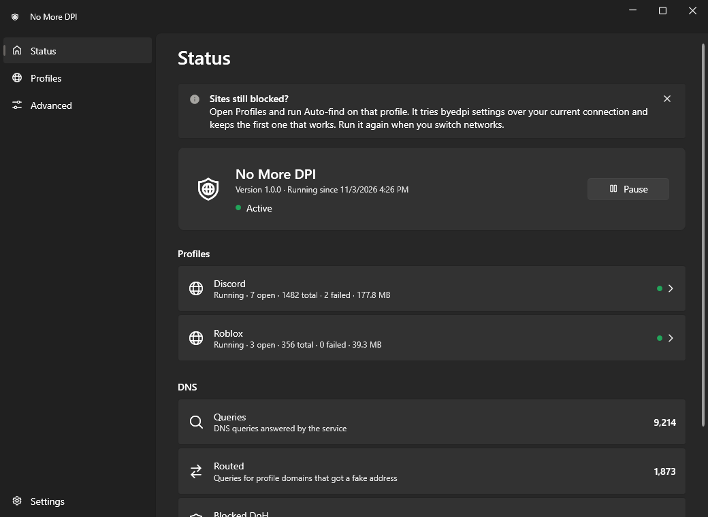
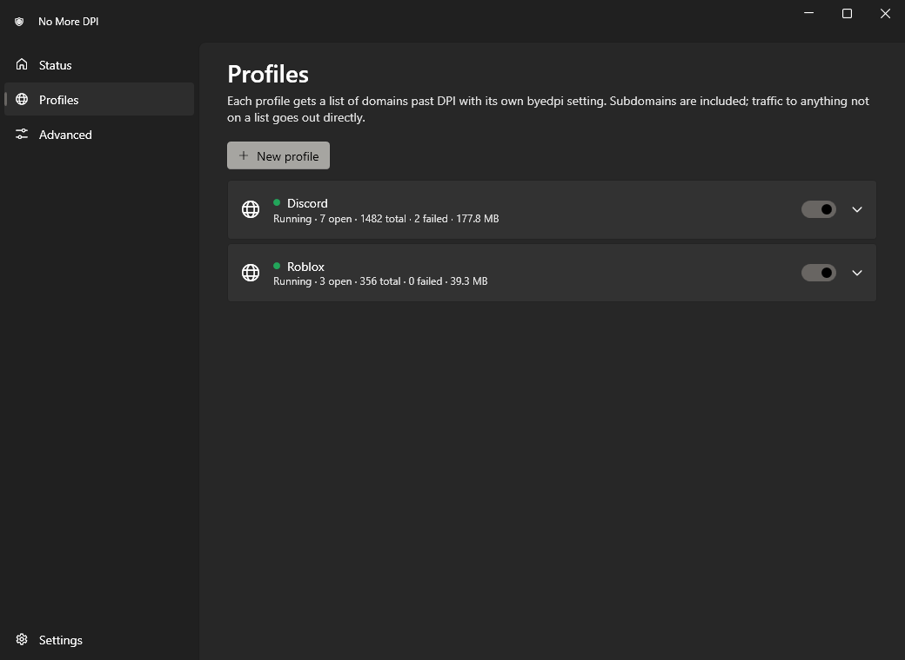
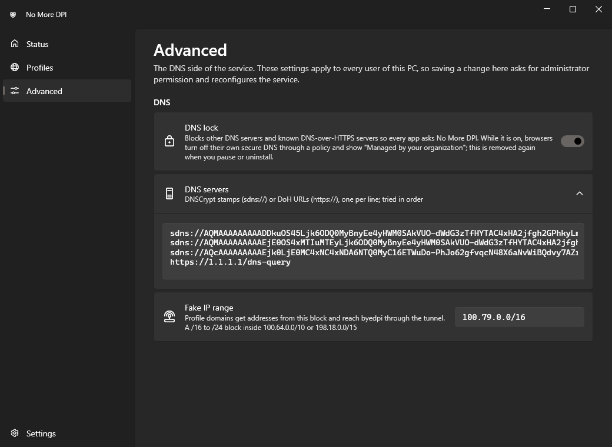
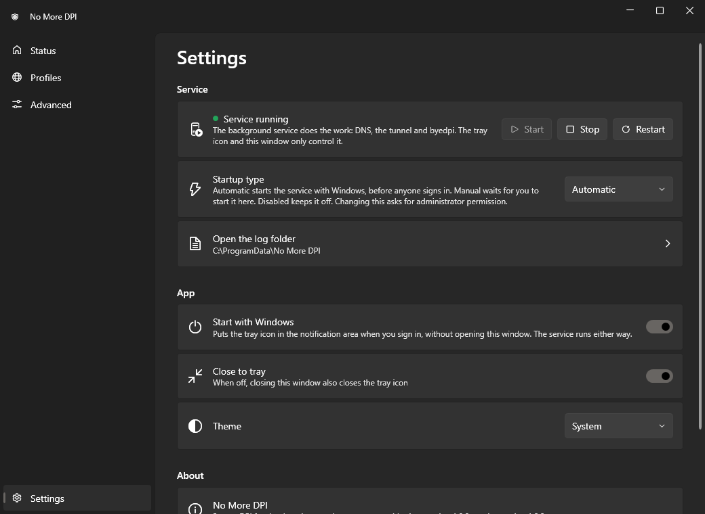

<p align="center"></p>

<h1 align="center">No More DPI</h1>

<p align="center">System-wide DPI bypass for the sites you choose, on Windows 10 and 11.</p>

Some networks use deep packet inspection (DPI) to block or slow down particular sites, for
example Discord or Roblox. No More DPI gets those sites working again without a VPN and
without proxy settings in each app. You list domains; connections to them go through
[byedpi](https://github.com/hufrea/byedpi), which reshapes the start of the TLS connection so
the DPI system no longer recognises it. Everything else on your PC goes out as before.

<p align="center"></p>

## Features

- **Per domain, not per app.** The Discord app, your browser and Roblox all follow the same
  rule; subdomains are included.
- **Nothing else is touched.** Only listed domains go through the bypass. Other traffic goes
  out directly, unchanged.
- **Encrypted DNS.** Names are resolved over DNSCrypt or DNS-over-HTTPS, so your network
  cannot tamper with the answers.
- **Auto-find.** One click tries known byedpi settings over your current connection and keeps
  the first one that works.
- **Fails open.** If the service crashes or is stopped, your DNS goes back to what it was.
  Your internet does not go down with it.
- **Tray app and service.** A Windows service does the work; the tray icon and window only
  control it.

## Requirements

- Windows 10 version 1809 or later, or Windows 11, 64-bit (x64).
- Administrator rights to install, uninstall and change the machine-wide DNS settings.
- Nothing else: the .NET runtime is included in the app.

## Install

1. Download `NoMoreDPI-<version>-setup.exe` from [Releases](../../releases/latest). Each
   release also lists the file's SHA-256; you can check it with
   `Get-FileHash .\NoMoreDPI-<version>-setup.exe` in PowerShell.
2. Run it. Windows SmartScreen may say it "protected your PC" because the installer is not
   code-signed. Choose **More info → Run anyway**.
3. A green ring in the notification area means it is active.
4. No sites are included. Open **Profiles**, click **New profile** and list the domains of
   the site you need, one per line. If the site still doesn't open, click **Auto-find** on
   that profile. Do it again when you move to a different network.

## Use

| Tray icon | Meaning |
|---|---|
| green | active |
| grey | paused (everything goes out directly) |
| red | error (open the window for details) |
| yellow | the service is not running |

Click the icon to open the window:

- **Status**: what is running and how much traffic each profile carries. Pause and resume.
- **Profiles**: add, edit or remove profiles. Each profile has its own domain list, its own
  byedpi arguments and its own byedpi process. **Auto-find** tests a list of known
  arguments against the profile's first domain and saves the first one that works twice in
  a row.
- **Advanced**: DNS servers (DNSCrypt `sdns://` stamps or `https://` DoH URLs), the DNS lock
  and the fake IP range. These apply to every user of the PC, so saving a change asks for
  administrator permission.
- **Settings**: control the **service** (start, stop, restart, startup type: Automatic, Manual
  or Disabled), start with Windows, close to tray, theme, logs, uninstall.

<p align="center">
  
  
</p>
<p align="center"></p>

### Profile arguments

A profile's arguments are byedpi desync options, for example `--tlsrec 1+s` or
`--split 1 --disorder 1`. See byedpi's documentation for what they do. Only long option
names are accepted, and only options that change how packets are sent: options that set the
listening address, read or write files, or detach the process are refused, because byedpi
runs with the service's privileges. `--fake-data`, `--hosts` and `--ipset` accept inline data
(`:text`) but not file paths.

### About the DNS lock

The DNS lock is on by default. It stops apps and browsers from bypassing No More DPI with
their own DNS, which would break the per-domain routing. To do this it blocks other DNS
servers and turns off the browsers' built-in "secure DNS" through policy. While the lock is
active, Chrome, Edge, Brave, Vivaldi, Opera and Firefox therefore show **"Managed by your
organization"**. Everything is put back when you pause, turn off the lock or uninstall.

## How it works

```
app ──DNS──▶ 127.0.0.1:53 (No More DPI)
               ├─ profile domain → fake address 100.79.x.x (real IP resolved over encrypted DNS)
               └─ anything else  → the encrypted DNS answer, unchanged
app ──TCP──▶ 100.79.x.x ──▶ "No More DPI" adapter (Wintun) ──▶ that profile's byedpi ──▶ real IP
```

1. The service points every network adapter that has a DNS server at its own resolver on
   `127.0.0.1` and `::1`. It resolves names over DNSCrypt or DoH.
2. Names that belong to a profile get an address from a private "fake" block
   (`100.79.0.0/16` by default). Only that block is routed into a virtual adapter (Wintun),
   so no other traffic can reach it.
3. Connections that arrive on the adapter are handed to that profile's byedpi process, which
   connects to the real address and applies its tricks to the TLS handshake.
4. For profile domains, QUIC (UDP 443) is dropped so browsers fall back to TLS over TCP, which
   byedpi can work on, and IPv6 answers are withheld so apps use the fake IPv4 address.

[docs/ARCHITECTURE.md](docs/ARCHITECTURE.md) has the details and the design notes.

## Limitations

- No More DPI is not a VPN and not an anonymity tool. Your network still sees which IP
  addresses you connect to and how much data you send; byedpi only makes the handshake hard
  for DPI to classify. It does not help against blocking by IP address.
- An app that connects to a hard-coded IP, or that uses its own encrypted DNS to a server
  the lock doesn't know, is not matched by domain.
- Only TCP is sent through byedpi. Voice and game traffic that does not start with a DNS
  lookup (for example Discord voice servers, Roblox game servers) is not routed. It is
  usually not blocked.
- Whether a byedpi setting works depends on the network. On some connections (for example
  some mobile or relayed paths), packet-splitting tricks (`--split`, `--disorder`) have no
  effect and only TLS record splitting (`--tlsrec`) does. Auto-find sorts this out.
- While the DNS lock is on, DNS servers other than No More DPI's are unreachable: names
  that only your router, a company network or a VPN's own DNS can answer (local host names,
  Active Directory, split-DNS VPNs) do not resolve. Pause No More DPI or turn off the lock
  for those networks.
- x64 only. No ARM64 build.

## Troubleshooting

- **A site in a profile still doesn't load.** Run **Auto-find** on the profile. Check that the
  site's other domains (CDNs, APIs) are in the list too; the service log shows connections
  that failed, with their domain. Close and reopen the app or browser so it resolves the
  names again.
- **The status says "Error".** Open the window; the Status page shows the reason. A common one
  is that another program already uses port 53 (a local DNS server or DNS proxy). Stop that
  program, then click **Resume**.
- **No internet after a crash or a forced shutdown.** The service puts DNS back when it starts
  again. If it cannot start, run `"C:\Program Files\No More DPI\nomoredpi-svc.exe" restore`
  (it asks for administrator permission), or uninstall.
- **Browsers say "Managed by your organization".** That is the DNS lock's policy, see above.
- **The window says the service is not running.** Use **Settings → Service → Start**, or
  check that its startup type is not Disabled.
- **Logs.** `%ProgramData%\No More DPI\service.log` (the service; **Settings → Open the log
  folder**) and `%LocalAppData%\No More DPI\ui-error.log` (the window, only if it hit an
  error).
- **Antivirus warnings.** Tools that change network behaviour, such as byedpi, are sometimes
  flagged. The bundled `ciadpi.exe` is the unmodified official byedpi release, see
  [third_party/README.md](third_party/README.md) for how to check it.

## Privacy and security

**What runs, and with which rights**

- `nomoredpi-svc.exe` runs as the Windows service **NoMoreDPI** under the LocalSystem
  account, starts automatically and is restarted by Windows if it fails. It starts one
  `ciadpi.exe` (byedpi) per enabled profile, also as LocalSystem, in a job object so they end
  with the service. Each one is a SOCKS5 proxy on `127.0.0.1` (ports 19090 and up) without a
  password, which any program on the PC could use.
- `NoMoreDPI.exe` (tray and window) runs as the signed-in user, without administrator rights.
  It talks to the service over the named pipe `\\.\pipe\nomoredpi`.
- Any signed-in user can pause and resume, start and stop the service, edit profiles and run
  Auto-find. Changing the DNS servers, the DNS lock or the fake IP range, the startup type,
  installing and uninstalling need administrator rights (UAC).

**What is changed in Windows, and how it is restored**

- The DNS servers of every adapter that has one are set to `127.0.0.1` (plus the adapter's
  original server as a fallback, used only if the service is not running) and `::1`. The
  original settings are saved to `%ProgramData%\No More DPI\dns-state.json` first and put
  back on pause, service stop, uninstall, and on the next start after a crash.
- A network adapter named **No More DPI** (Wintun) is created with the address `100.79.0.1/16`
  while active, and removed on pause or stop.
- With the DNS lock on: Windows Filtering Platform filters, in a dynamic session that
  disappears when the service exits, block DNS (ports 53 and 853) to anything but this PC
  and block HTTPS (port 443) to a list of well-known public DoH resolver addresses (such as
  `1.1.1.1`, `8.8.8.8`, `9.9.9.9`) for every program except the service. The policy value
  `DnsOverHttpsMode=off` is set under `HKLM\SOFTWARE\Policies\` for Chrome, Edge, Brave,
  Chromium, Vivaldi and Opera, and `DNSOverHTTPS\Enabled=0` for Firefox. The previous values
  are saved to `browser-state.json` and restored on pause, stop and uninstall.
- While active, the names of well-known DoH services (for example `dns.google`,
  `cloudflare-dns.com`, Firefox's canary domain `use-application-dns.net`) are answered with
  "does not exist", so browsers keep using the system resolver.
- Setup adds a per-user autostart entry (`HKCU\...\Run`, "No More DPI") if you keep that
  option, and lets signed-in users start and stop the service.

**What leaves your PC**

- All DNS queries of the PC, not only those for profile domains, go to the configured
  encrypted resolvers. By default, tried in this order:
  1. Quad9 over DNSCrypt, `9.9.9.9:8443` and `149.112.112.9:8443` (Quad9's filtered service,
     which blocks known malicious domains),
  2. AdGuard DNS unfiltered over DNSCrypt, `94.140.14.140:5443`,
  3. Cloudflare over DNS-over-HTTPS, `https://1.1.1.1/dns-query`.

  You can replace them under **Advanced**. Your network sees encrypted traffic to these
  resolvers instead of plain DNS; the resolvers see the names you look up.
- Connections to profile domains go to the same servers as before, only with a reshaped
  handshake. Auto-find connects to the profile's first domain (or its probe host) a few
  times.
- Nothing else: no telemetry, no accounts, no update checks.

**What is stored on your PC**

- `%ProgramData%\No More DPI\`: `config.json` (profiles, DNS settings), `fakeip.json` (which
  fake address each profile domain got), the state files above and `service.log` (up to
  4 MB plus one older file). The log records service events, DNS changes and failed
  connections to profile domains with their names. The folder is writable only by
  administrators and the service, and readable by all users of the PC.
- `%AppData%\No More DPI\settings.json`: the window's own preferences.

## Uninstall

Use **Settings → Uninstall No More DPI**, or *Settings → Apps* in Windows. Uninstalling stops
and removes the service, the virtual adapter, the firewall filters, the browser policies and
the app, and restores your DNS settings. It asks whether to also delete your settings,
profiles and logs.

## Build from source

Requirements: [Go](https://go.dev/dl/) (the version in `go.mod`), the
[.NET 10 SDK](https://dotnet.microsoft.com/download) and, for the installer,
[Inno Setup 6](https://jrsoftware.org/isinfo.php). PowerShell 5.1 or 7.

```powershell
./build.ps1 -Installer
```

The output goes to `dist\`: `NoMoreDPI.exe` (tray and window, WPF), `nomoredpi-svc.exe`
(service and admin commands), `nomoredpi-cli.exe` (the same as a console program),
`ciadpi.exe`, `wintun.dll`, `THIRD-PARTY-LICENSES.txt` and, with `-Installer`,
`NoMoreDPI-<version>-setup.exe` and its `.sha256`.

Options: `-Version 1.2.3`, `-ProjectUrl https://…` (the link behind **Project page** in the
app and in the setup), `-CiadpiFromSource` (compile `ciadpi.exe` from `third_party\byedpi`
with MinGW-w64 GCC, or another compiler given with `-CC`, instead of using the official
release binary), `-Dev` (see below).

`build.ps1` refuses to build if `third_party\byedpi-bin\ciadpi.exe` or
`third_party\wintun\wintun.dll` differs from the hashes pinned in
`third_party\upstream.json`. Where those files come from is in
[third_party/README.md](third_party/README.md).

## Development

```
cmd/nomoredpi/   service, admin commands and CLI (Go)
internal/        engine: resolver, tunnel, byedpi supervisor, DNS takeover, DNS lock, IPC
ui/              tray icon and window (WPF, .NET 10)
installer/       Inno Setup script
third_party/     byedpi source and release binary, Wintun DLL, their licenses and pins
tools/           license collection, third-party verification, ciadpi source build, icon
tests/           elevated end-to-end scripts
```

- **Unit tests:** `go test ./cmd/nomoredpi/ ./internal/config/ ./internal/engine/ ./internal/ipc/`
  run offline. The other Go
  tests (`internal/dnsserver`, `internal/autofind`) talk to real resolvers, and the
  Auto-find test needs `dist\ciadpi.exe` and a network where discord.com is DPI-blocked.
- **CLI:** `nomoredpi-cli help` lists the commands: `status`, `logs`, `pause`, `resume`,
  `autofind <profile>`, `set-dns …`, `set-startup …`, `restore`, and `run` (the engine in the
  foreground, as administrator, with the service stopped).
- **Developer build:** `./build.ps1 -Dev` builds Go with `-tags debug` (adds the `stacks`
  command, a goroutine dump from the service) and a Debug UI where
  `NoMoreDPI.exe --demo [status|profiles|advanced|settings]` shows the window with made-up
  data and no service, for screenshots and UI work (the images in `docs/screenshots/` were
  taken this way). Release builds contain neither.
- **End-to-end scripts** (`tests\`): run them elevated, on a test machine or VM, after
  `build.ps1 -Installer`. They install and uninstall No More DPI, change system DNS while they
  run, and need a network where discord.com and www.roblox.com work through byedpi. `cycle.ps1`
  and `e2e.ps1` load test profiles for those two sites from `test-profiles.ps1` and put your
  own `config.json` back afterwards.
  - `cycle.ps1`: setup (install or upgrade), service and ACL checks, graceful stop, then
    `e2e.ps1`, then start again.
  - `e2e.ps1`: runs `nomoredpi-cli run` with the service stopped and checks the DNS lock,
    fake addresses, routing, ciadpi restarts, load, pause/resume, crash fail-open and
    `restore`. Port 53 must be free.
  - `selfheal.ps1`: removes the adapter's address and checks that the service repairs it.
  - `uninstall.ps1`: runs the uninstaller silently and checks that everything is back.

  Results go to `tests\*-result.txt`.
- **Third-party checks:** `tools\verify-third-party.ps1` downloads the upstream byedpi and
  Wintun archives and compares them with the vendored files; `tools\collect-licenses.ps1`
  writes `THIRD-PARTY-LICENSES.txt` (`build.ps1` runs it).
- **CI:** every push to `main` and every pull request runs the third-party check, `go vet`,
  the offline tests, a source build of ciadpi, and builds the setup (uploaded as a workflow
  artifact). Pushing a `v*` tag builds the setup and attaches it, with its `.sha256`, to a
  draft release.

## Legal

No More DPI is a tool for reaching sites that a network blocks or slows down. Laws on
circumventing network restrictions differ between countries, and some networks (workplaces,
schools) have their own rules. You are responsible for making sure your use is legal and
allowed where you are. The software is provided "as is", without warranty of any kind (see
[LICENSE](LICENSE)).

No More DPI is an independent project. It is not affiliated with, endorsed by or sponsored by
Discord, Roblox, the byedpi project, WireGuard LLC, Microsoft, Quad9, AdGuard, Cloudflare or
any other service or company mentioned here. Their names are used only to describe what the
software works with.

## License and credits

No More DPI is released under the [MIT License](LICENSE). Bundled and linked third-party
software is listed in [THIRD-PARTY-NOTICES.md](THIRD-PARTY-NOTICES.md); the installer puts the
full license texts next to the program.

It is built on:

- [byedpi](https://github.com/hufrea/byedpi) by hufrea, which does the actual DPI bypass,
- [Wintun](https://www.wintun.net/) and [wireguard-go](https://git.zx2c4.com/wireguard-go)
  by WireGuard LLC,
- [tun2socks](https://github.com/xjasonlyu/tun2socks) and [gVisor](https://gvisor.dev/)'s
  network stack,
- [dnscrypt](https://github.com/ameshkov/dnscrypt) and [miekg/dns](https://github.com/miekg/dns),
- [tailscale/wf](https://github.com/tailscale/wf) for the Windows Filtering Platform,
- [WPF UI](https://github.com/lepoco/wpfui) for the window.
